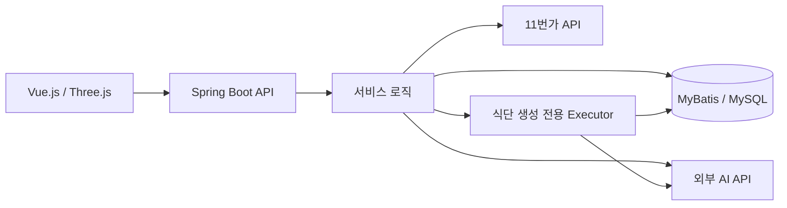

# AvoFit — AI 식단·장보기 관리 서비스

사용자의 신체정보와 목표를 바탕으로 식단을 생성하고, 필요한 식재료를 11번가 상품에 연결하는 2인 팀 프로젝트입니다. BMI 단계에 맞는 3D 아바타로 체형을 시각화합니다.

- **개발 기간**: 2025.11 ~ 2025.12, 4주 (포트폴리오 기준)
- **팀 구성**: 풀스택 2명
- **본인**: [류병선 · ryubyeongsun](https://github.com/ryubyeongsun)
- **성과**: SSAFY 14기 최종 페어(관통) 프로젝트 우수상 (포트폴리오 기재)
- **후속 개선**: 2026.08.15 식단 생성 전용 Executor 도입 및 구간별 순차 처리
- [시연 영상·발표 자료](https://drive.google.com/drive/folders/1dfmQnl0CSuvlWtrIJdcFdw_Y8KkmliGW)
- [포트폴리오 소스](https://github.com/ryubyeongsun/bs_00.github.io)

## 담당한 부분

| 구분 | 구현·기여 내용 | 코드 |
| --- | --- | --- |
| 장보기 상품 추천 | 검색어 정규화, 부적합 상품 필터링, 예산·용량·재료명 기반 후보 평가, AI 의미 판단 보완 | [ShoppingServiceImpl](backend/src/main/java/com/dietcoach/project/service/ShoppingServiceImpl.java), [ProductScorer](backend/src/main/java/com/dietcoach/project/service/shopping/ProductScorer.java) |
| 구매 수량 계산 | 상품명에서 포장 용량을 추출하고 필요량 대비 권장 구매 개수와 비용 계산 | [ProductWeightParser](backend/src/main/java/com/dietcoach/project/util/shopping/ProductWeightParser.java), [MealPlanServiceImpl](backend/src/main/java/com/dietcoach/project/service/MealPlanServiceImpl.java) |
| 3D 초기 웹 연동 | 전달받은 GLB 자산을 Three.js GLTFLoader로 렌더링하고 BMI Level별 모델 선택 연결 | [Character3D.vue](frontend/src/components/dashboard/Character3D.vue) |
| 프로젝트 종료 후 개선 | 첫 7일 우선 생성 흐름을 유지하면서 나머지 8~30일을 전용 Executor의 한 작업에서 순차 생성 | [AsyncConfig](backend/src/main/java/com/dietcoach/project/config/AsyncConfig.java) |

3D 모델링 자산은 외부 도움으로 전달받았습니다. 모델링 자체와 팀원의 후속 수정은 본인의 단독 구현 범위에 포함하지 않습니다. 식단·대시보드 등 전체 서비스 기능에는 팀원의 구현이 함께 포함되어 있습니다.

## 주요 흐름과 설계



### 식재료를 실제 구매 상품으로 연결

1. `닭가슴살 100g`처럼 수량이 포함된 재료명을 정규화합니다.
2. 카테고리 검색과 상품명 필터링으로 후보를 가져옵니다.
3. 재료명·예산·용량을 기준으로 점수를 매기고 상위 후보를 추립니다.
4. 후보가 3개 이상이면 AI로 의미적 적합성을 보완합니다. AI 실패 시 규칙 기반 후보로 대체합니다.
5. 유효한 포장 용량이 있으면 `ceil(필요량 / 포장 용량)`으로 구매 개수를 계산합니다.
6. 구매 개수를 반영한 비용을 검증하고, 전체 예상 비용이 예산의 115%를 초과하면 고비용 항목부터 제외합니다.

예를 들어 필요량 1,200g, 포장 500g, 상품 가격 4,000원이면 권장 구매 개수는 3개, 예상 비용은 12,000원입니다. 포장 용량을 알 수 없으면 기본 1개로 처리하므로 실제 구매 전 확인이 필요합니다. 개별 후보 예산 가드의 허용치는 125%이며 전체 예산 검증의 115%와 구분됩니다. 배송비·실시간 재고·결제는 연동하지 않습니다.

### 식단 비동기 처리

첫 7일은 요청 스레드에서 생성합니다. 나머지 8~30일은 `CompletableFuture.runAsync(..., mealTaskExecutor)`로 실행하며, 한 작업 안에서 구간별로 순차 처리합니다. 전용 풀은 **Core 5 / Max 10 / Queue 50**입니다. 작업별 상태 API·영속 큐·자동 재시도는 없고 기존 식단 조회 API로 결과를 확인합니다. 처리 시간 개선율이나 동시 처리량을 측정한 수치는 없습니다.

## 기술 스택

| 영역 | 기술 |
| --- | --- |
| Backend | Java 17, Spring Boot 3.5.8, Spring Security, JJWT 0.11.5 |
| Data | MyBatis Spring Boot Starter 3.0.5, MySQL 8.0 |
| Frontend | Vue 3, Vite 7, Three.js, Chart.js, Axios |
| Build | Maven Wrapper, npm lockfile |

인증은 Access/Refresh Token을 분리하고 Refresh Token 해시를 DB에 저장하며 재발급 시 Rotation을 수행합니다. 인증 구현과 리소스별 소유권 검증은 별도 문제이며, 보완 과제는 [아키텍처 문서](ARCHITECTURE.md)에 정리했습니다.

## 로컬 실행

필요 환경: **JDK 17**, **Node.js 22.12 이상**, **MySQL 8.0**, 외부 연동용 API 키. 프론트엔드 의존성의 정확한 버전은 `frontend/package-lock.json`을 따릅니다.

### 1. DB 준비

빈 개발용 DB를 만든 뒤 스키마를 한 번 적용합니다. 기존 DB에는 재적용하지 않습니다. 자동 스키마 초기화는 꺼져 있으며 서버 재시작 시 데이터를 삭제하지 않습니다.

```bash
mysql -u root -p -e "CREATE DATABASE yumyum CHARACTER SET utf8mb4;"
mysql -u root -p yumyum < backend/src/main/resources/schema/schema.sql
```

### 2. 환경 변수

[.env.example](.env.example)을 참고해 IDE 또는 셸의 환경 변수에 등록합니다. **Spring Boot는 루트 `.env`를 자동으로 읽지 않습니다.** DB 접속은 `SPRING_DATASOURCE_URL`, `SPRING_DATASOURCE_USERNAME`, `SPRING_DATASOURCE_PASSWORD`로 덮어쓸 수 있습니다.

- `JWT_SECRET`: 실제 실행용 임의 비밀값
- `GMS_API_KEY`: 식단 생성·상품 후보 의미 판단
- `ELEVENST_API_KEY`: 실제 상품 검색
- 운영 설정은 `SPRING_PROFILES_ACTIVE=prod`와 `.env.example`의 `PROD_*` 변수를 사용합니다.

실제 키가 없거나 API 호출에 실패하면 일부 경로는 템플릿 식단 또는 대체 결과를 사용합니다. 응답의 `source`와 로그를 함께 확인해야 실제 연동 여부를 판단할 수 있습니다.

### 3. Backend

```bash
cd backend
./mvnw spring-boot:run
```

### 4. Frontend — 별도 터미널

```bash
cd frontend
npm ci
npm run dev
```

화면은 `http://localhost:5173`, API는 `http://localhost:8080`입니다. Vite가 `/api` 요청을 백엔드로 전달합니다. 백엔드에 남아 있는 정적 빌드 사본은 최신 프론트 소스와 다를 수 있어 개발 확인에는 Vite를 사용합니다.

## 검증

DB·실제 외부 API 없이 실행하는 단위 테스트:

```bash
cd backend
./mvnw -Dtest=ProductWeightParserTest,IngredientQueryNormalizerTest,WeightRecordServiceTest test
```

프론트엔드 빌드:

```bash
cd frontend
npm ci
npm run build
```

전체 `./mvnw test`에는 DB 연결을 사용하는 `DietCoachApplicationTests`가 포함됩니다. 별도 테스트 DB를 준비하고 접속 환경 변수를 지정한 뒤 실행해야 합니다. 단위 테스트 통과가 실제 외부 API·DB 통합 검증을 대신하지는 않습니다.

## 문서

- [아키텍처와 남아 있는 설계 과제](ARCHITECTURE.md)
- [실제 Controller 기준 API 목록](API_SPECIFICATION.md)
- [개발·커밋 규칙](CONTRIBUTING.md)
- [면접 준비: 코드 근거와 예상 질문](docs/INTERVIEW_GUIDE.md)

## 다음 개선 과제

- 비동기 시작 시점과 트랜잭션 커밋 경계, 구간 저장의 원자성 보강
- 사용자·식단·체중 리소스별 소유권 검증과 접근 권한 회귀 테스트
- 상품명 숫자·단위·묶음 표현 및 추천 탈락 후 대체 경로의 경계 사례 보강
- Frontend/Backend의 BMI Level 정책 통일
- 작업 상태·실패·재시도 정책과 다중 인스턴스 캐시 설계
